# Scratch Everywhere on Original Xbox — notes for Mike

[Game clips](#games-in-action) · [Key fixes](#fixes-worth-reviewing) · [Adding games](#what-i-meant-by-adding-games-is-tricky)

We've installed twenty games on a **128MB Xbox** using NXDK. The normal build
opens the project browser, launches installed games and returns after exit.
There is real gameplay progress below; twenty installed does not mean every
level, replay path or audio check is finished. Retail 64MB support is untested.

## Games in action

These are short **captures from our physical Xbox**, including footage saved
during earlier tests. GIFs keep the recorded pace; they are silent. The results
beside them summarize testing across sessions, not just what each clip shows.
Game titles link to their Scratch sources. **Prepared** means we changed a
separate game copy; a **profile** only maps controller buttons to existing keys.

| | |
| --- | --- |
| **[Ultra Bird](https://discord.com/channels/428359196719972353/428399682239332354)** 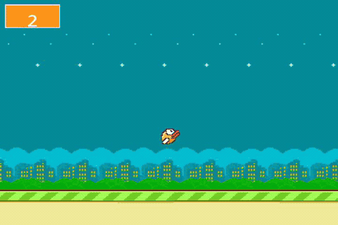 Six pipes scored; original archive. | **[Hopper Heros](https://scratch.mit.edu/projects/1184969400/)** 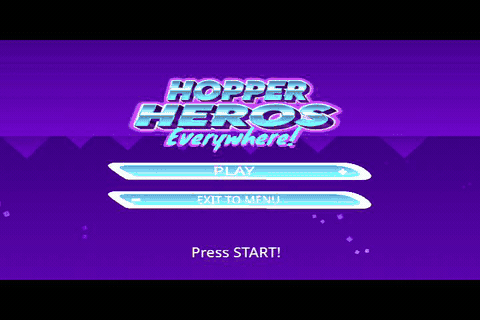 Movement/jump and replay; original Everywhere variant. |
| **[Catch Apples](https://scratch.mit.edu/projects/124652800/)** 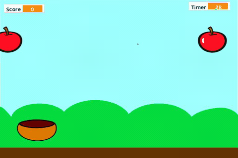 22 points at timer expiry; original + profile. | **[Maze Starter](https://scratch.mit.edu/projects/10128431/)** 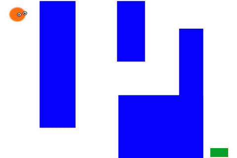 Full maze/replay; prepared copy. |
| **[Snake](https://scratch.mit.edu/projects/511466864/)** 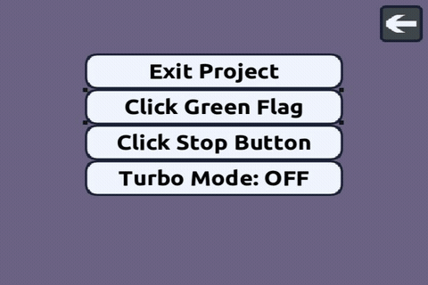 Four directions, fruit and loss; original + profile. | **[Appel](https://scratch.mit.edu/projects/60917032/)** 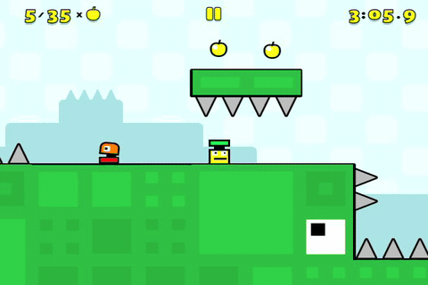 Terrain restored; clip shows seven apples. Original + profile. |
| **[Tetris](https://scratch.mit.edu/projects/469540467/)** 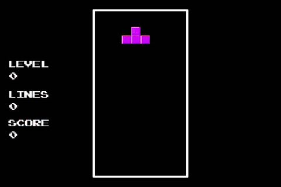 Ten lines/Level 1; original + profile. | **[Frogger](https://scratch.mit.edu/projects/12221773/)** 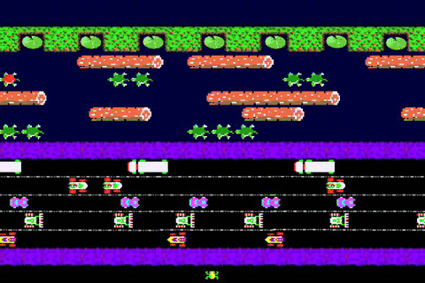 Six pads in one round; prepared copy. |
| **[Breakout](https://scratch.mit.edu/projects/11007566/)** 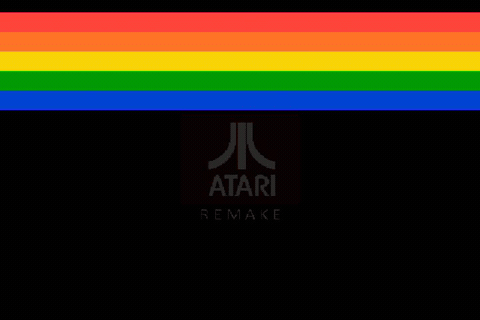 Full board at 1,940; prepared copy. | **[PacMan](https://scratch.mit.edu/projects/13701368/)** 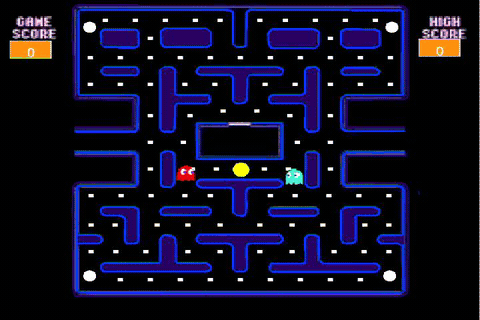 Walls, pellets and replay; original + profile. |
| **[Space Invaders](https://scratch.mit.edu/projects/253610111/)** 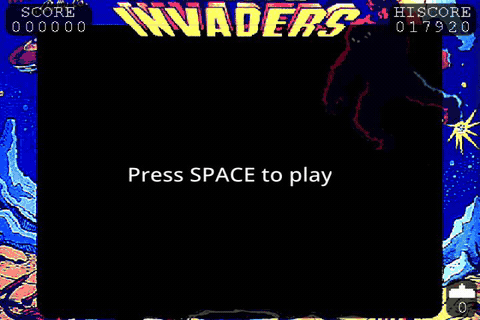 450 points, loss/replay; original scripts + profile. | **[Asteroids](https://scratch.mit.edu/projects/32219470/)** 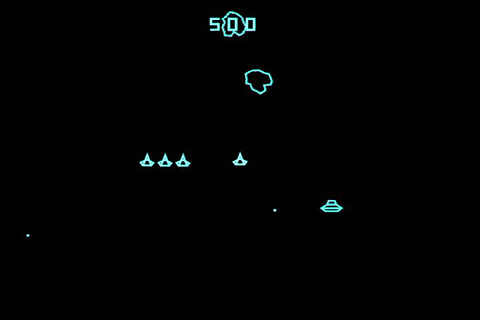 9,200 points and replay; original scripts + profile. |
| **[Sokoban](https://scratch.mit.edu/projects/24490009/)** 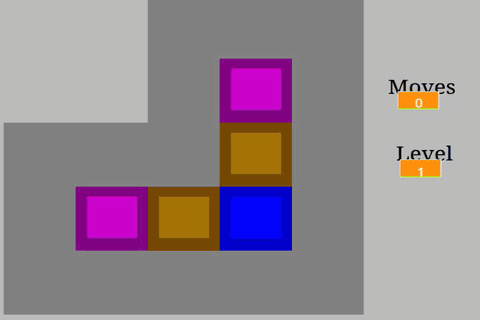 Puzzles 1–3 and repaired ten completed; prepared copy. | **[2048](https://scratch.mit.edu/projects/19554088/)** 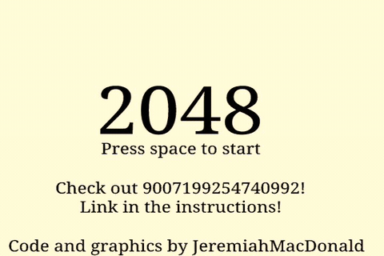 Unseeded 2,048-tile win; prepared A acknowledgement. |
| **[Retro Racing](https://scratch.mit.edu/projects/26999060/)** 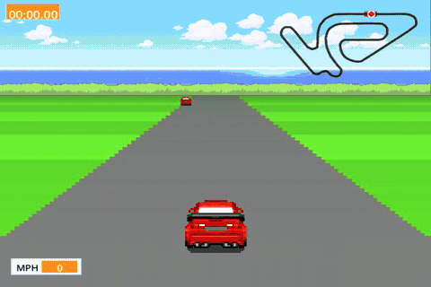 Acceleration, braking and steering; original scripts + profile. | **[Hill Climb Racing](https://scratch.mit.edu/projects/56667360/)** 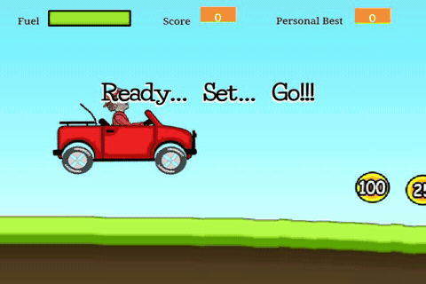 Jeep/motorcycle, crash/replay; original scripts + profile. |
| **[Super Mario Bros.](https://scratch.mit.edu/projects/196684240/)** 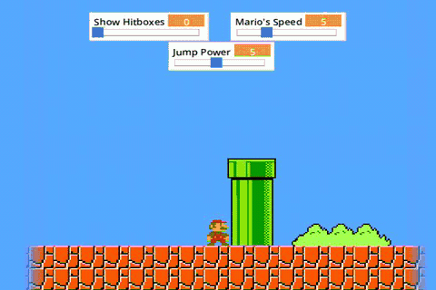 Opening pipes and death recovery; prepared copy. | **[Doodle Jump](https://scratch.mit.edu/projects/399123680/)** 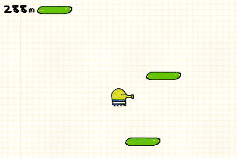 1,044 m and automatic replay; original scripts + profile. |
| **[Jumper](https://scratch.mit.edu/projects/103069687/)** 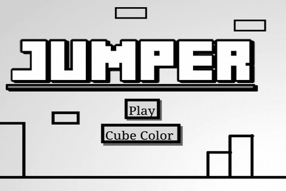 Levels 1–4 cleared; prepared controls/readiness copy. | **[Connect Four](https://scratch.mit.edu/projects/52769452/)** 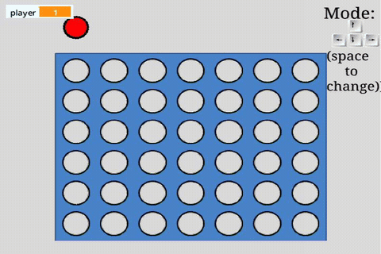 Both colors and three win directions; prepared copy. |

Hopper links to the original Scratch game; we tested its Everywhere variant.
Ultra Bird's link is the Discord example channel; its standalone project URL
was not recorded. See the [full test matrix](xbox-game-qualification.md) for
versions, hashes and outstanding checks. Appel's full Level 1 win used a
diagnostic build; the normal-build repeat currently reaches checkpoint two.

## Fixes worth reviewing

Since your Xbox fork points users toward upstream, the most useful handoff is
small fixes with reproducers, grouped by where they apply. These links are
commits in our fork, not requests to pull the entire branch.

| Area | Change and commit |
| --- | --- |
| Shared runtime | [Default absent inputs to false/zero/empty](https://github.com/ZacharyLeahan/scratcheverywhere-nxdk/commit/30b0f84cb9588ce9d13966312756099c0baaa855). Fixed Appel's extra setup/clone overflow without raising the clone limit. This commit also contains a separate Xbox GPU-range patch. |
| Shared SB2 compatibility | [Computed list selectors in both engines](https://github.com/ZacharyLeahan/scratcheverywhere-nxdk/commit/08523f82cef42babb478e6a2a2d4d5ad4e153d2b), [localized stage monitors](https://github.com/ZacharyLeahan/scratcheverywhere-nxdk/commit/63f2b65ea259dea2d51971d1a429decd613661d7) and [named costumes](https://github.com/ZacharyLeahan/scratcheverywhere-nxdk/commit/55708a6bf854c43850e52570fbf60b476d2d289f). Helped Connect Four, Breakout and PacMan. |
| Shared audio | [Keep resampler phase and decoder lookahead](https://github.com/ZacharyLeahan/scratcheverywhere-nxdk/commit/72fd448e82dca3c4c44f323d0205c0c213b15824). Deterministic fixture checked on host, xemu and Xbox. |
| Xbox rendering | [Deterministic vertex setup](https://github.com/ZacharyLeahan/scratcheverywhere-nxdk/commit/f217b0b1fcaaaf93fddcf7c808720b0d26378070); GPU allocations stay within the DMA-addressable range on expanded-RAM hardware. [Background](xbox-startup-rendering.md). |
| Xbox color sensing | [Include pen pixels](https://github.com/ZacharyLeahan/scratcheverywhere-nxdk/commit/b83fe88c6dae4a89cc77760ceeac3e053a460f83) and [sample exact bitmap texels](https://github.com/ZacharyLeahan/scratcheverywhere-nxdk/commit/e0acbc881187907c1ee4a44ef0874e03445b78b6). Final 38-case fixture passed in xemu and on Xbox; earlier collision-mask edge retention is shared. |
| Xbox input | [Controller switching/replay/reset](https://github.com/ZacharyLeahan/scratcheverywhere-nxdk/commit/9d5e5adfe65ec834c893eec3a991c38e2e65e2b4), [SB2 profiles](https://github.com/ZacharyLeahan/scratcheverywhere-nxdk/commit/985f0a72adc723a1795548d34865a0ee0b8536e6) and [menu confirmation isolation](https://github.com/ZacharyLeahan/scratcheverywhere-nxdk/commit/54e668e1d9eab378f42b3e48535f9b99fd0e95c5). |
| Individual games | Reproducible [preparation scripts](../scripts) repair the separate copies marked above. These are project adaptations, not engine fixes; keep them separate in upstream review. |

Some commits mix shared and Xbox changes and would need splitting before an
upstream PR. The [build/sync notes](xbox-fork-build.md) explain how our changes
were adapted around upstream's VM and ROMFS work.

## What I meant by “adding games is tricky”

**Selecting installed games works. Adding a new game requires a computer:**
get the `.sb3`/`.sb2`, return the Xbox to XBMC, FTP it to
`E:\ScratchEverywhere\`, optionally copy its controller profile, then relaunch.
That transfer/setup loop is the cumbersome part when playing with my daughter.

There is already a per-project **Controls editor** in the code; our test
mappings were supplied as reproducible sidecars. Useful next steps would be
an in-app archive receiver/import screen, clearer access to that editor and
simple arrows/WASD presets. This would improve installation without promising
that every downloaded Scratch project is compatible.

## How we can make this useful upstream

- Start with the [empty-input reproducer](../examples/make-empty-input-test.py)
  or [resampler tests](../tests/audio_resampler_test.py): one small fix, expected
  result and exact test scope. Shared fixes still need other-platform review.
- Keep Xbox backend/dependency changes separate from prepared game copies.
- Use the [detailed matrix](xbox-game-qualification.md) for unfinished gameplay,
  audio and intermittent menu handoff issues. Remote KVM input delivery also
  remains unresolved; it is not proof of the same fault on physical controllers.

[Build instructions](xbox-fork-build.md) · [Gameplay capture provenance](mike-gameplay/README.md)
